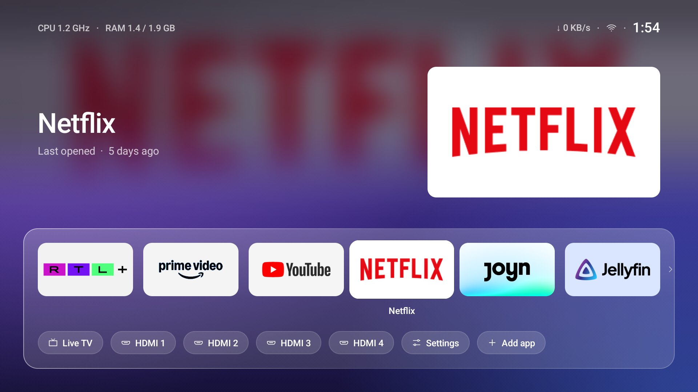
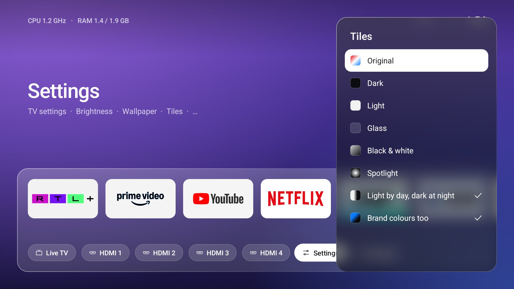
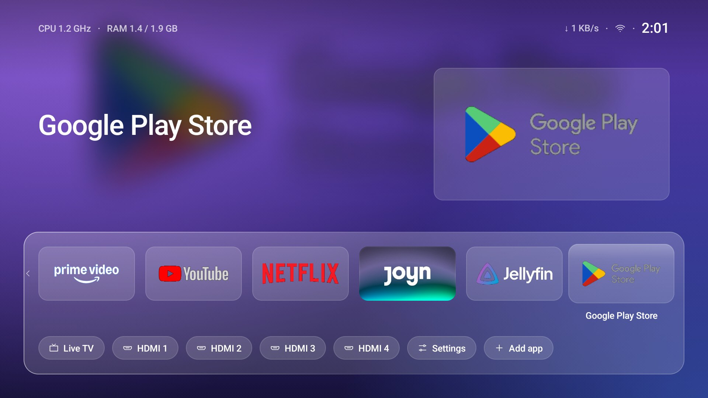
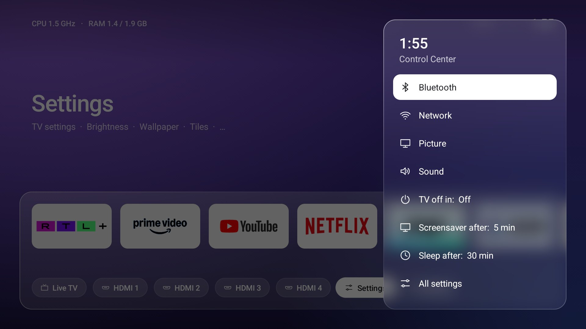
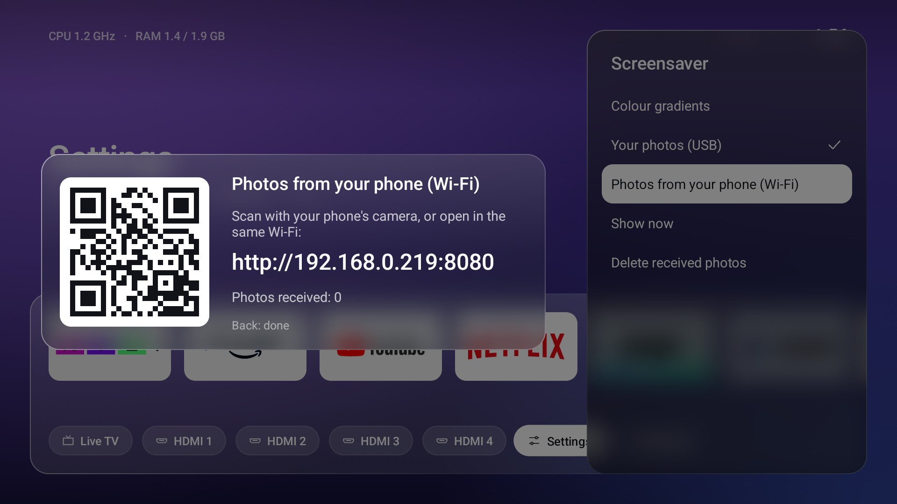
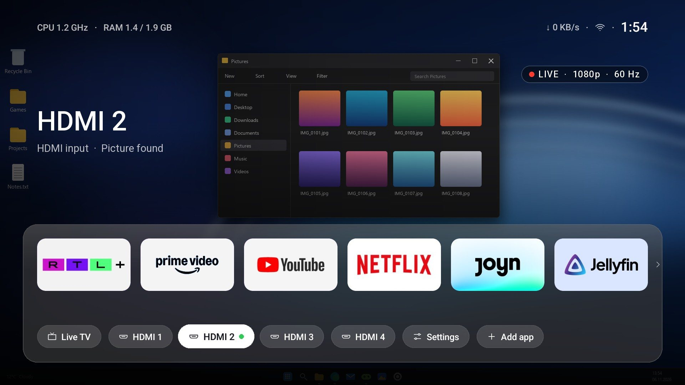
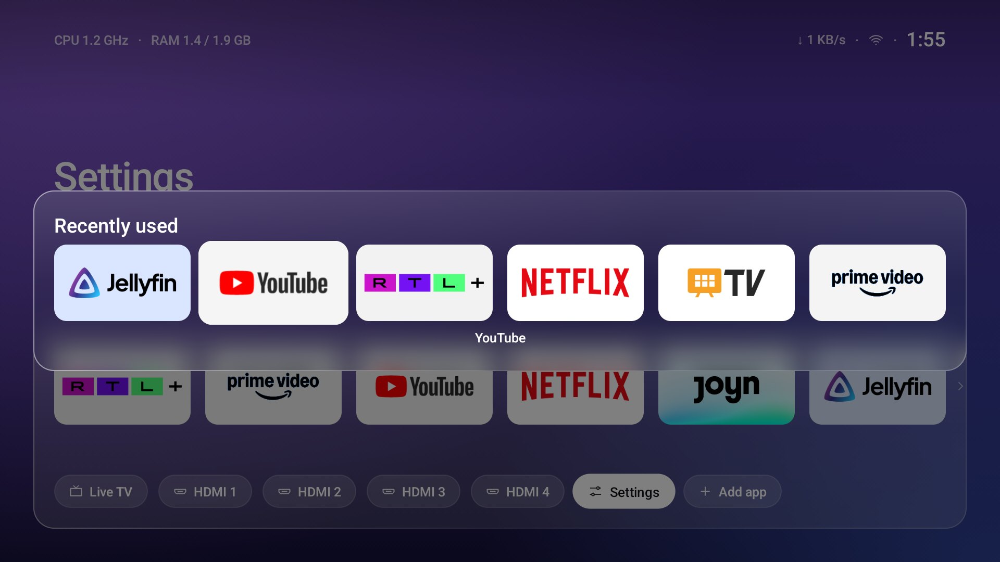

<div align="center">

# Glasshouse

### A fast, glassy home screen for Android TV and Google TV.

Built and tuned on a 1.9 GB Google TV, where the stock home screen had become painfully slow.

**[Click through it in your browser →](https://delaybrain.github.io/glasshouse/)**



</div>

> [!IMPORTANT]
> **So far tested on exactly one TV:** a PEAQ 65GQU-5024C (built by Changhong, MediaTek chip, Google TV on Android 14, 1.9 GB RAM). The install, undo and cleanup scripts come from tv-detox, which was used on many TVs, but everything Glasshouse added (the home screen's looks, Control Center, the remote buttons, kids lock, photos over Wi-Fi) has only run there. Other TVs may differ, especially their remotes. Please [open an issue](https://github.com/Delaybrain/glasshouse/issues) with your TV's model either way.
>
> **The ready-made APK in [Releases](https://github.com/Delaybrain/glasshouse/releases) is exactly what runs on that PEAQ.** It may well run on other Android TVs, but nobody has checked. **On any other TV, build it from this code instead**, best by letting Claude Code or another coding agent do it with the [setup prompt](#first-setup-with-an-ai-assistant): it builds Glasshouse on your computer, checks it fits your TV and installs it. If a remote button does nothing, set it on the TV under Settings → **Remote buttons**.

> [!WARNING]
> **Use at your own risk.** Changing a TV's home screen and turning off system apps over adb always carries some risk of leaving the TV stuck at the logo, restarting over and over, or needing a factory reset, which erases everything on it. It may also affect your warranty. Before you start, find out how to factory reset your TV (often with buttons on the TV itself) and note your logins. This is a free hobby project with **no warranty and no liability** for any damage or data loss (see [Disclaimer](#disclaimer)).

## What you get

- **Your apps on a glass dock.** The big picture and name at the top follow the focus. The row scrolls past six apps and wraps round. Hold OK on an app to move, replace or remove it.
- **HDMI inputs that know what's plugged in.** A dot for a device that's on (over HDMI-CEC), and a live preview behind the page while an input is focused.
- **Glass panels.** Menus, panels and Control Center float on a blurred copy of the page, with a tint that adapts so every panel is equally bright, and a rim that catches the light. All drawn once, never per frame.
- **Seven tile looks.** Original, dark, light, glass, black & white, spotlight, or light by day and dark at night. Banners on white or black get their background turned round, brand colours optionally too.
- **Status bar you choose.** Clock, network (Wi-Fi bars or a cable), date, CPU speed, RAM, download speed, off timer.
- **Remote buttons that work.** Home, the settings gear, the apps button and the TV button are caught before Google TV takes them (an accessibility service, *HomeGuard*). Hold Home for the apps you used last. Another remote? Set which button does what on the TV, under Settings → Remote buttons.
- **Control Center** on the gear button: Bluetooth, network, picture, sound, an off timer, when the screensaver and sleep start.
- **Kids lock.** A PIN for the apps you pick. It also asks when an app is opened by voice or a link.
- **Photos from your phone.** Scan a QR code on the TV, pick photos on your phone (or drop them in on a computer) for the screensaver or the wallpaper. A tiny web server runs on the TV only while that card is open.
- **Screensaver** with a big clock over your apps' colours, or your photos.
- **Photos that fit.** A photo of another shape (4:3, upright) is cut at the top, middle or bottom, or shown whole on a soft copy of itself, picked under *Photo position* for the wallpaper and the screensaver. *Delete photos* lists them with small pictures; each one, or all of them, is deleted after one question.
- **Back up and restore** your setup: from the menu, over Wi-Fi from a phone, or with `backup.sh` / `restore.sh`.
- **18 languages**, following the TV's.

<p>






</p>

<sub>The HDMI picture is a mock-up (a real screenshot with a drawn PC desktop behind it): the TV blocks screenshots while a live picture plays. All other pictures are real screenshots.</sub>

## Fast on a slow TV

Measured on a PEAQ 65GQU (MediaTek, 1.9 GB RAM, Android 14), 150 presses along the app row:

| | |
|---|---|
| Janky frames | 0.85 % |
| 99th percentile frame | 38 ms |
| Memory (PSS) | about 70 MB |
| CPU while idle | about 1 % (the status bar's two-second update) |

How: the wallpaper and glass are drawn into bitmaps once, there are no elevation shadows or live blurs, banners and their washes are cached, and status text has fixed sizes so updates never lay out the page.

## First setup with an AI assistant

The easiest way: let [Claude Code](https://claude.com/claude-code) or another coding agent on your computer do it, and just press OK on the remote when it asks.

1. **Turn on developer mode on the TV.** Settings → System → About → press *Android TV OS build* 7 times. Then, in Developer options, turn on **USB debugging** (and **network debugging** if your TV has it).
2. **Open the agent on a computer in the same Wi-Fi as the TV**, and paste this in:

```text
Help me set up Glasshouse on my Android TV and make the TV faster.
My TV is a <brand and model>.

1. Before you change anything, tell me in plain words: turning off
   system apps has some risk (a few TVs got stuck at the logo or kept
   restarting), and you can make mistakes. undo.sh and your list of
   changes turn everything back on. Ask me to confirm.
2. Connect to my TV over Wi-Fi with adb. Walk me through anything I
   need to press on the TV (like "Allow debugging").
3. Get https://github.com/Delaybrain/glasshouse and read its README
   and docs/debloat.md. Run candidates.sh and show me, in plain words,
   what's safe to turn off, what the TV needs, and which apps I use.
   Check free memory.
4. Ask me before every change. Turn apps off (pm disable-user), never
   uninstall them. Write every change and how to undo it into a list
   file, in the format check.sh reads.
5. Never turn off: Google Play services, Google Play, Settings,
   System UI, setup apps, the keyboard, Bluetooth, the HDMI inputs and
   the TV's tuner/input framework, or anything else the TV needs to
   start. On Google TV leave Google TV's own home screen on unless I
   say otherwise (see "Replacing Google TV's home screen" in the README).
   If you're not sure, leave it on.
6. Unless my TV is a PEAQ 65GQU (the only one tested), build Glasshouse
   from the code instead of using the release APK: build.sh, or
   build.ps1 after setup-tools.ps1 on Windows. Show me anything you
   change in the code.
7. Install Glasshouse with install.sh (it uses the APK you built) and
   these apps: <your apps>. Then press Home and check it comes up.
   Test the remote's Home, settings and apps buttons with me. If one
   does nothing, walk me through Settings > Remote buttons on the TV
   (README: "Remote buttons"); don't change the code for that.
8. Turn off animations. Ask me if the TV is OLED; if it is, keep the
   screensaver on.
9. Wait 30 seconds, restart the TV once, and check it starts normally
   and Glasshouse comes up. Show me free memory before and after.
10. Remind me to turn debugging off on the TV when we're done.
```

3. **Turn debugging off** when it's done. While it's on, other devices on your network can ask to control the TV. Turn it back on only for `undo.sh` or updates.

## Install by hand

You need a computer with `adb` ([platform tools](https://developer.android.com/tools/releases/platform-tools)) on the same network as the TV.

1. **Turn on developer mode** on the TV, as above.
2. **Install:**
   ```sh
   sh install.sh <TV_IP>
   ```
   It installs Glasshouse, makes it the home screen, turns on HomeGuard and the screensaver, and grants the extras below. To pick the apps: `sh install.sh <TV_IP> "com.netflix.ninja,com.google.android.youtube.tv"`.
3. **Turn debugging off** in Developer options when you're done. While it's on, other devices on your network can ask to control the TV.

Without a build of your own, `install.sh` downloads the release APK, the one made on the tested PEAQ. **On another TV, build it first**: `sh build.sh` (or `build.ps1` on Windows) with Java 17 and the Android SDK (platform and build-tools 34); `setup-tools.ps1` fetches both on Windows. `install.sh` then installs your build (`out/glasshouse.apk`) instead.

### What install.sh grants, and why

Each one is optional: without it, only that feature stays off.

| Grant | For |
|---|---|
| `appops GET_USAGE_STATS` | "last opened", Home going back to the app you left, Hold Home |
| `pm grant WRITE_SECURE_SETTINGS` | the sleep row in Control Center; HomeGuard putting itself back after updates; keeping the waits you pick |
| `appops WRITE_SETTINGS` | the screensaver row in Control Center |
| `pm grant BLUETOOTH_CONNECT` | Control Center's Bluetooth row |
| HomeGuard (accessibility) | the remote's Home, gear, apps and TV buttons |
| `READ_MEDIA_IMAGES` | photos from a USB stick (asked on the TV when you pick that) |
| `MANAGE_MEDIA` (appops, by `install.sh`) | deleting a photo asks once, in Glasshouse's look; without it Android asks a second time |

### Undo

```sh
sh undo.sh <TV_IP>
```
turns back on whatever was turned off, removes Glasshouse and brings your TV's own home screen back. `restore-stock.sh` and `check.sh` work from a list of changes, for those who also cleaned up system apps.

## Remote buttons

On Google TV the Home, settings and apps buttons go to Google TV's own screens, even with another home screen set. Glasshouse catches them first with an accessibility service called **HomeGuard** (in the TV's settings it's *Glasshouse: remote buttons*).

- `install.sh` turns it on. By hand: `sh homeguard.sh <TV_IP> on` (and `off`), or TV Settings → Accessibility → *Glasshouse: remote buttons*.
- Android turns accessibility services off when their app is updated or force-stopped. Glasshouse turns HomeGuard back on by itself the next time it comes up (that's what `WRITE_SECURE_SETTINGS` is for). `homeguard.sh off` tells it not to.

What the buttons do as standard, as on the tested PEAQ remote:

| Button | Key it sends | Glasshouse |
|---|---|---|
| Home | `HOME` | the home screen; **hold it** for the apps you used last |
| Gear (settings) | `NOTIFICATION` (others send `SETTINGS`) | Control Center |
| Apps (grid of dots) | `ALL_APPS` | the list of all apps |
| Person | `PROFILE_SWITCH` | the TV's account page |
| TV | `GUIDE` | Live TV; inside Live TV it's passed on, for its programme guide |
| Input (TV with an arrow) | `TV_INPUT` | left alone: the TV's own input picker |
| Everything else | | left alone |

**Another remote? Set the buttons on the TV.** Settings → **Remote buttons** lists each job (Home, All apps, Control Center, Live TV, Account, and *Off* for a button that should do nothing at all) with the buttons that do it now. Pick one and press the button you want on the remote: from then on it does that job, and nothing it did before. A job can have more than one button. *Remove its buttons* leaves a job without one, and those buttons go back to the TV. *Reset to standard* puts everything back as in the table, after asking.

- Until you change something there, the standard buttons stay exactly as they were, so an update never changes a remote that already works.
- The arrows, OK, Back, volume, power and the digits can't be given a job: they're needed to use the TV and to type the kids lock PIN.
- It needs HomeGuard on to catch Home and the buttons Google TV takes. Without it, the buttons still work on the home screen itself.
- Your choice is in backups too.
- **The voice button on MediaTek TVs** (Peaq, Changhong) is a button the TV keeps for itself: it never reaches Glasshouse, so it can't be set here. With Google's voice search turned off (`com.google.android.katniss`) it opens a page to pair the remote for voice; HomeGuard closes that page again as soon as it shows.

A button that doesn't show up there at all, or that your TV keeps for itself? Run `adb shell getevent -l`, press it, and [open an issue](https://github.com/Delaybrain/glasshouse/issues) with your remote's model and the `KEY_...` line.

## Replacing Google TV's home screen

> [!CAUTION]
> **Not recommended.** On some Google TVs and Chromecasts, turning off Google TV's home screen (`com.google.android.apps.tv.launcherx`) left them restarting over and over, and only a factory reset helped. That's why `install.sh` leaves it on: HomeGuard brings Glasshouse up instead, and you lose nothing.

**We did it anyway on the PEAQ**, to free its memory and so Home goes straight to Glasshouse. What was done, and how to undo it:

1. Made sure the TV stays reachable over the network on port 5555 (`adb tcpip 5555`; on the PEAQ that survives restarts), so it can be fixed even if the home screen breaks. A USB cable is the better fallback, if your TV has a debugging USB port.
2. `GOOGLE_TV=1 YES_SETUP=1 sh install.sh <TV_IP>`. It turns off (`pm disable-user`, not uninstall) Google TV's home screen and its setup app (`com.google.android.tungsten.setupwraith`, which otherwise takes over Home), and saves both on the TV's undo list.
3. Restarted the TV and checked it comes up on Glasshouse. It has, through many restarts, since late October 2026.
4. To undo: `sh undo.sh <TV_IP>` turns both back on. By hand: `adb shell pm enable com.google.android.apps.tv.launcherx` and the same for the setup app.

## Cleaning up the TV

Glasshouse started as part of making a slow TV fast again. [docs/debloat.md](docs/debloat.md) explains how to turn off what you don't need, safely and reversibly, with `candidates.sh` listing every app with a verdict.

> [!WARNING]
> **At your own risk.** Turning off system apps can leave a TV stuck at the logo or restarting. Turn apps off, never uninstall them, keep the undo list, and leave Google TV's own home screen on (`install.sh` does). On OLED TVs keep the screensaver on.

## Good to know

- **Tested on** one TV, a PEAQ 65GQU-5024C with Android 14 (see the top). Older Android versions may work; the photo features need Android 10 or newer.
- **What apps can't do:** "Continue watching" rows from Netflix and others, CPU use in percent, and temperatures are closed to apps on Android TV. Glasshouse shows what it can (CPU speed, RAM).
- **Privacy:** nothing leaves your home network. The photo web server runs only while its card is open and takes only pictures or a backup.

## Disclaimer

Glasshouse and its scripts are provided "as is", without warranty of any kind. You use them at your own risk and are responsible for what you run on your TV. The authors and contributors are not liable for any damage, data loss, broken or unusable devices, lost warranty, or other harm arising from using them, as far as the law allows. Nothing here is support from, or approved by, your TV's maker or Google. If you're not comfortable fixing a TV that won't start (adb, factory reset), don't turn off system apps. The full terms are in the [LICENSE](LICENSE).

## Credits

Glasshouse began as a fork of **[tv-detox](https://github.com/Ansub/tv-detox)** by **Ansub Khan** (MIT): its install, undo and check scripts, the debloat guide and the first home screen are the base this grew from. The cleanup that started it all used **[android-tv-debloat-toolkit](https://github.com/seun-novodev/android-tv-debloat-toolkit)** by **seun-novodev** (MIT). Thank you both.

App names and logos in the screenshots belong to their owners. Glasshouse is not affiliated with Google, Apple or any app shown.

## License

MIT, see [LICENSE](LICENSE). The original tv-detox copyright stays in it.
